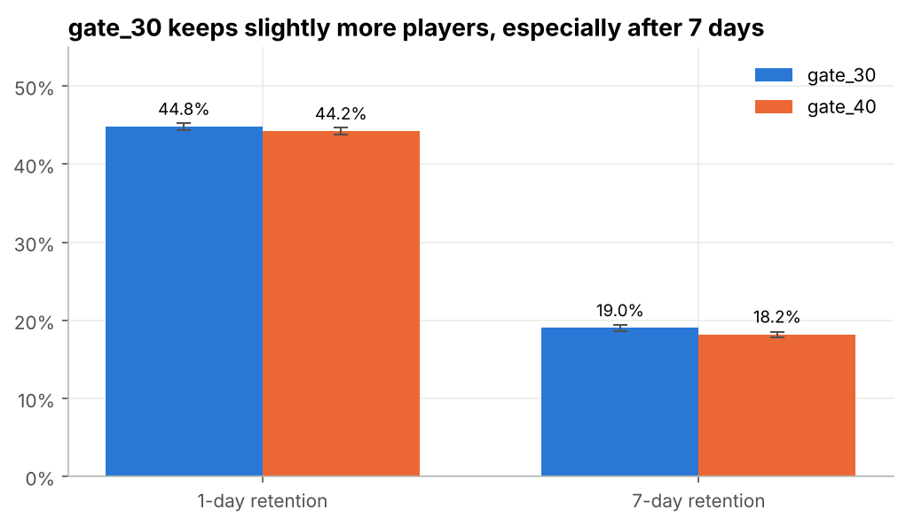
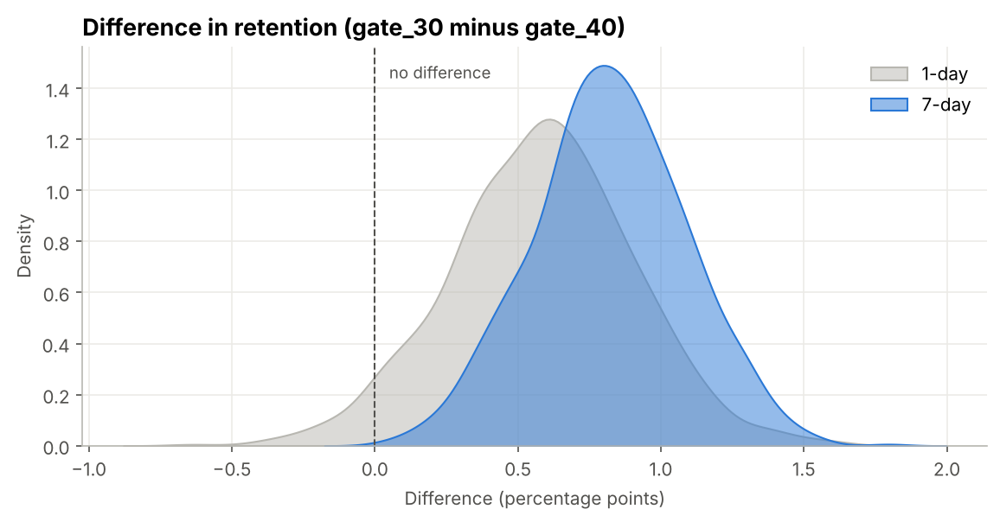

# Mobile Game A/B Test: Cookie Cats Gate Placement

Analysis of an A/B test on 90,189 players of **Cookie Cats**, a mobile puzzle game. The team tested moving the first "gate" (where players have to wait or pay to continue) from **level 30 to level 40**. I wanted to find out whether this change affects how many players come back after 1 day and after 7 days.

**Tools:** Python (pandas, NumPy, SciPy), Matplotlib, Seaborn, Jupyter
**Methods:** hypothesis testing (two-proportion z-test, chi-square), bootstrap resampling, Mann-Whitney U test, sample ratio mismatch check

---

## Result: keep the gate at level 30

| Metric | gate_30 (control) | gate_40 (test) | Difference | p-value | Significant? |
|---|---|---|---|---|---|
| 1-day retention | 44.82% | 44.23% | 0.59 pp | 0.074 | No |
| 7-day retention | **19.02%** | **18.20%** | **0.82 pp** | **0.0016** | **Yes** |

- **7-day retention drops significantly with gate_40.** In all 1,000 bootstrap resamples, gate_30 retained more players at day 7 (95% interval for the difference: 0.30 to 1.33 pp).
- For every 1 million installs, gate_40 would keep about **8,000 fewer players** at day 7.
- Game rounds played were almost identical in both groups (median 17 vs 16).





---

## Approach

**1. Data checks**
- No missing values or duplicate players.
- **Sample ratio mismatch:** the split is 49.6% / 50.4%, and a chi-square test shows this is unlikely to be random (p = 0.009). The gap is small and I compare rates, not counts, but in a real company this should be checked with engineering. Listed as a limitation.

**2. Outlier**
- One player logged 49,854 rounds in 14 days (~3,500 a day); the next highest is 2,961. Removed as a likely bot or logging error. Players with 0 rounds were kept, since leaving early is part of what retention measures.

**3. Statistical tests** (α = 0.05, two-sided)
- **Two-proportion z-test**, written out step by step, with 95% confidence intervals.
- **Chi-square test of independence** as a cross-check (same p-values).
- **Bootstrap** with 1,000 resamples to see the full distribution of possible differences.
- **Mann-Whitney U** for game rounds, because they are heavily skewed (not normal).

**Why might an earlier gate help?** A gate forces a break. Players who pause at level 30 come back still enjoying the game, while players who can binge to level 40 may get bored sooner (*hedonic adaptation*).

---

## Project structure

```
├── data/
│   └── cookie_cats.csv              raw A/B test data (90,189 players)
├── notebooks/
│   └── ab_test_analysis.ipynb       full analysis
├── images/                          charts
├── outputs/                         test results and group summary (CSV)
└── requirements.txt
```

## How to run

```bash
git clone https://github.com/bhawna346/mobile-game-ab-testing.git
cd mobile-game-ab-testing
pip install -r requirements.txt
jupyter notebook notebooks/ab_test_analysis.ipynb
```

## Limitations and next steps
- Small sample ratio mismatch; the cause should be investigated before acting.
- No revenue data, so the business impact is estimated through retention only.
- Retention is only tracked up to day 7.
- Next: test an earlier gate (for example level 20) and include in-app purchase data.

## Data source
[Mobile Games A/B Testing – Cookie Cats](https://www.kaggle.com/datasets/yufengsui/mobile-games-ab-testing) (Kaggle). Original data from Tactile Entertainment, shared via DataCamp.
